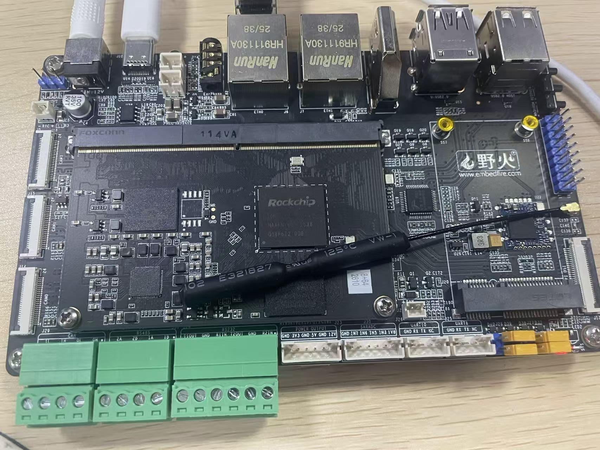
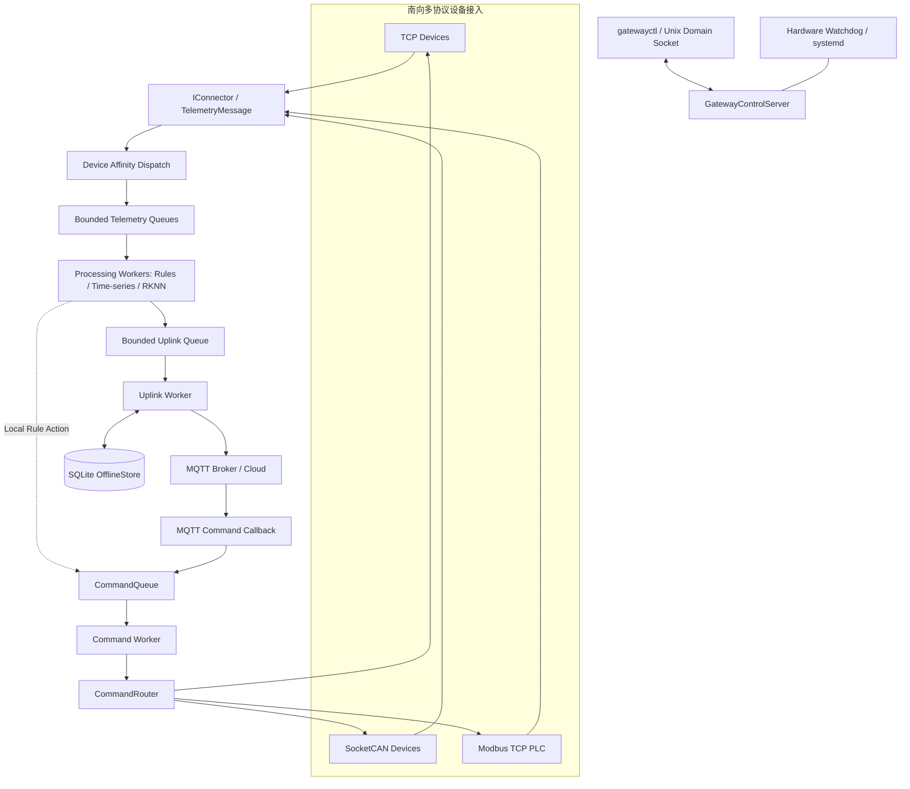
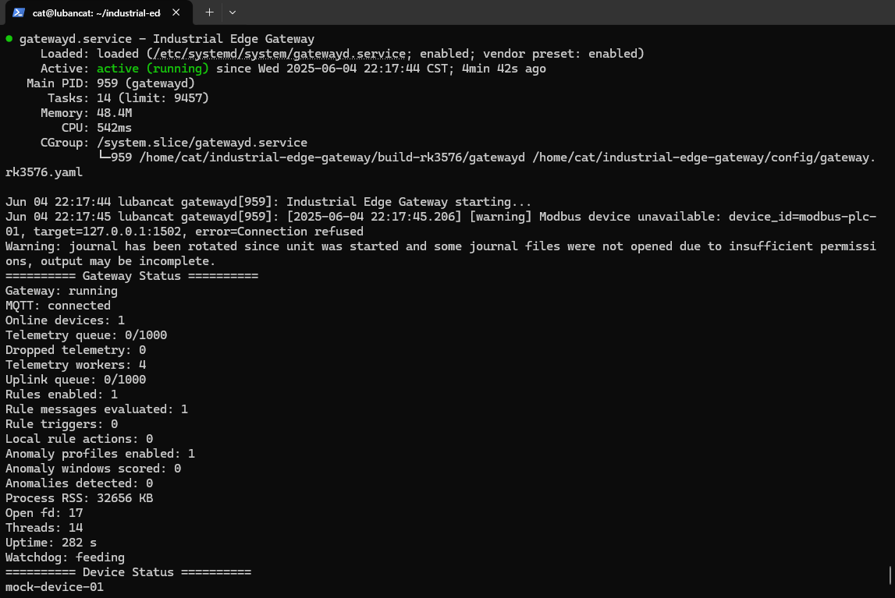
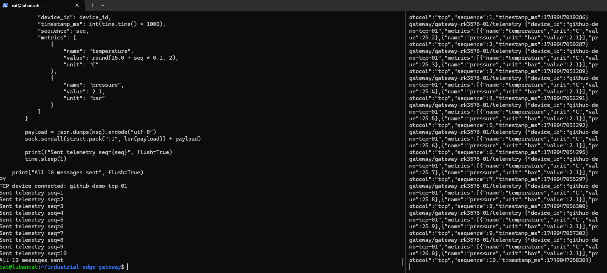
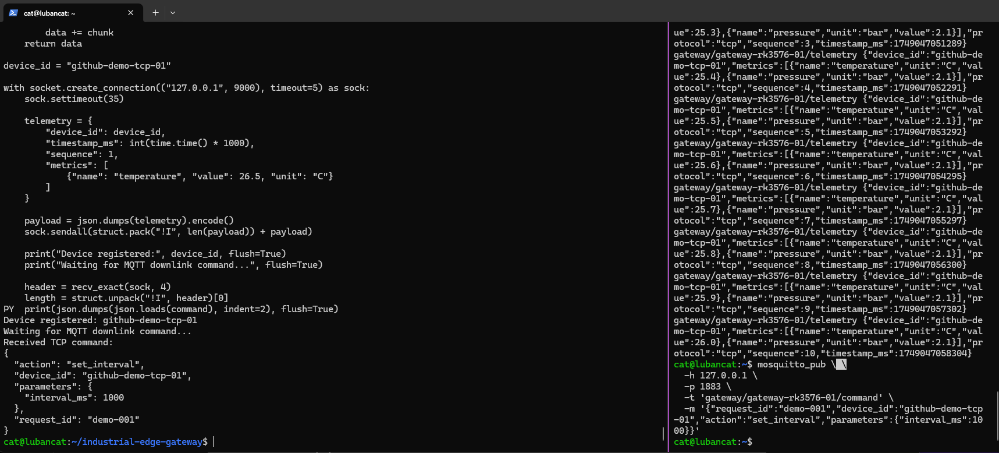
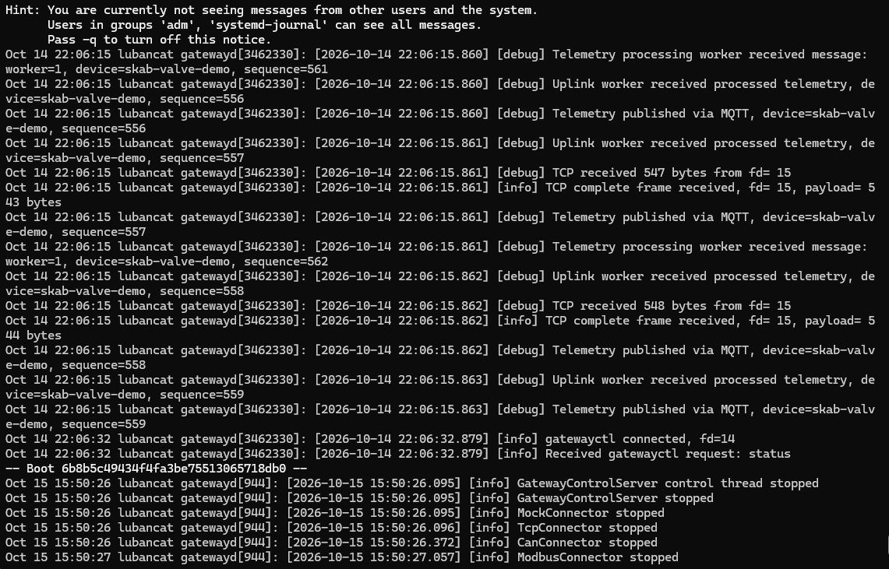
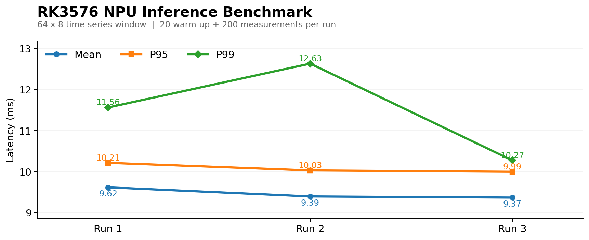
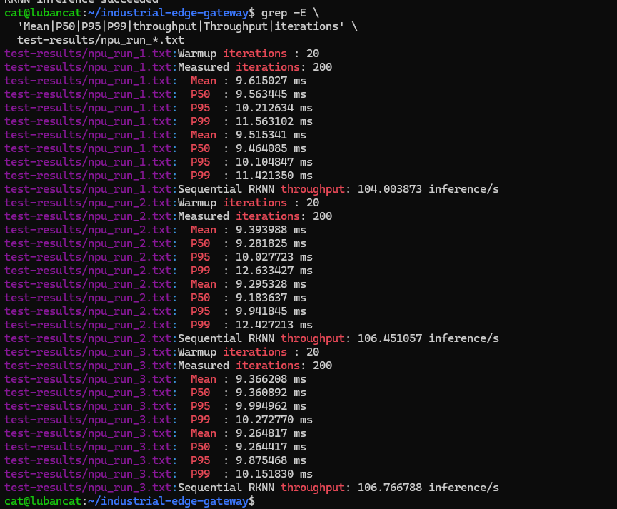

# Industrial Edge Gateway

**基于 C++17 与嵌入式 Linux 的多协议工业边缘智能网关**

面向工业设备异构接入、可靠数据传输与边缘智能分析，开发了一套运行于 ARM Linux 平台的多协议网关系统。项目以 `gatewayd` 为核心，通过 **TCP / SocketCAN / Modbus TCP** 完成南向数据采集，通过 **MQTT + SQLite** 实现北向可靠上报与双向控制，并在 **RK3576 NPU** 上部署多变量时序异常检测模型。

**核心技术：** `C++17` · `Embedded Linux` · `epoll` · `eventfd` · `SocketCAN` · `Modbus TCP` · `MQTT` · `SQLite` · `Multi-Worker` · `RKNN` · `Buildroot` · `systemd`

## 项目成果

| 指标 | RK3576 实测结果 |
| :-- | :-- |
| TCP 并发处理 | **100 个 TCP 客户端**，约 **500 msg/s**，5000 条遥测完整送达 |
| 长时间稳定运行 | **26 h**，50 客户端、200 msg/s，累计约 **1872 万条**遥测，**Dropped = 0** |
| MQTT 离线恢复 | Broker 故障后恢复补发 **1125 条遥测** |
| 进程恢复 | systemd 故障恢复测试中，约 **3.45 s** 恢复 MQTT 连接 |
| RK3576 NPU | 64 × 8 时间窗口，三轮 Benchmark 平均 **9.458 ms**，串行吞吐平均 **105.74 次/s** |
| 异常检测效果 | **F1 = 0.8441**；509 个验证窗口分类结果与 PyTorch 一致 |

### RK3576 开发板

<p align="center">
  
</p>
<p align="center"><sub>RK3576 工业开发板 · ARM Linux 实机部署平台</sub></p>

## 1. 系统架构



### 遥测上行链路

```text
工业设备 → TCP / CAN / Modbus Connector
        → TelemetryMessage
        → 按 device_id 分配处理 Worker
        → 规则引擎 / 时序异常检测 / RKNN NPU
        → ProcessedTelemetryQueue
        → Uplink Worker
        → MQTT QoS 1 → Cloud
                      ↕
                SQLite OfflineStore
              （离线持久化与恢复补发）
```

- **统一设备模型**：各协议 Connector 将原始设备数据转换为 `TelemetryMessage`，通过统一入口交给网关核心。
- **设备亲和性调度**：按照 `device_id` 将消息分配至固定处理 Worker，维护设备级处理顺序和滑动窗口状态。
- **两级有界队列**：接入处理与云端上行分离，提高并发采集与上行传输的协调能力。
- **可靠数据链路**：MQTT QoS 1、SQLite 持久化队列、自动重连与离线消息恢复补发。

### 远程控制下行链路

```text
MQTT Command (JSON)
    → CommandConverter → DeviceCommand
    → CommandQueue → Command Worker
    → CommandRouter (device_id → IConnector)
         ├─ TCP: pending_commands_ → eventfd → epoll I/O → send()
         ├─ CAN: SocketCAN Frame
         └─ Modbus TCP: Holding Register Write
```

TCP 命令下发采用**业务线程和 I/O 线程分离**的设计：Command Worker 封装命令并写入待发送队列，通过 `eventfd` 通知 TCP I/O 线程；后者利用 `epoll` 管理目标连接，并通过发送缓冲区与动态 `EPOLLOUT` 完成非阻塞发送、部分发送处理。

## 2. 核心工程实现

| 核心模块 | 实现内容 |
| --- | --- |
| 多协议接入层 | `IConnector` 统一抽象，独立实现 TCP、SocketCAN、Modbus TCP Connector |
| TCP Reactor | `epoll + non-blocking Socket + eventfd`，长连接管理、半包/粘包处理、4 字节长度头协议、部分发送 |
| 多线程处理 | 多 Processing Worker、线程安全有界队列、设备亲和性分发、背压处理 |
| 统一业务数据 | `TelemetryMessage`、`ProcessedTelemetry`、`DeviceCommand`、`CommandRouter` |
| MQTT 上下行 | 遥测 QoS 1 发布、控制命令订阅、Broker 连接恢复 |
| 离线存储 | SQLite Store-and-Forward，断联期间持续缓存，恢复后自动补发 |
| 边缘规则 | 阈值检测、持续时间判断、冷却时间控制、本地下行控制 |
| NPU 智能推理 | PyTorch → ONNX → RKNN；64 × 8 时序窗口；RKNN Runtime 板端推理 |
| 设备运维 | `gatewayctl`、Unix Domain Socket、健康指标、systemd 自启动和硬件 Watchdog |

## 3. RK3576 实机运行与通信验证

### 3.1 网关运行状态

RK3576 实机完成 `gatewayd` 服务部署，使用 systemd 管理常驻服务，通过 `gatewayctl` 获取网关、设备及健康状态。

<p align="center">
  
</p>
<p align="center"><sub>gatewayd active (running) · MQTT connected · Dropped 0 · Watchdog feeding</sub></p>

该次运行状态显示：**MQTT 已连接、在线设备 1 个、Telemetry Queue 0/1000、Uplink Queue 0/1000、Dropped 0、14 个线程、17 个文件描述符**。系统已运行网关守护进程、通信模块及监控服务。

### 3.2 TCP → MQTT 遥测上报

测试使用 RK3576 本机 TCP 模拟设备发送 **10 条**遥测消息，通过 **4 字节长度头 + JSON Payload** 输入网关，MQTT 订阅端接收到对应 `sequence=1–10` 的上行数据。

<p align="center">
  
</p>
<p align="center"><sub>TCP Device Simulator → Gateway → MQTT Broker · 10 条遥测完整上报</sub></p>

验证内容：TCP 长连接接入、长度帧解析、Telemetry 转换、Processing Worker 处理及 MQTT 发布。

### 3.3 MQTT → TCP 控制命令下发

通过 MQTT 向 `github-demo-tcp-01` 发送控制命令，目标 TCP 客户端接收到完整的 `set_interval` JSON 命令，完成**云端发布 → 网关命令路由 → TCP 设备接收**的双向通信闭环。

<p align="center">
  
</p>
<p align="center"><sub>MQTT Command → CommandRouter → TcpConnector → TCP Client</sub></p>

```json
{
  "request_id": "demo-001",
  "device_id": "github-demo-tcp-01",
  "action": "set_interval",
  "parameters": {
    "interval_ms": 1000
  }
}
```

### 3.4 网关处理日志

<p align="center">
  
</p>
<p align="center"><sub>TCP 接收 / 遥测 Worker / Uplink Worker / MQTT 发布执行日志</sub></p>

## 4. RK3576 NPU 时序异常检测

### 4.1 模型部署与推理流程

在 RK3576 NPU 上集成工业多变量时序异常检测模型：

```text
PyTorch 训练模型
     ↓
ONNX 导出与模型转换
     ↓
RKNN 模型
     ↓
64 × 8 多变量时间窗口
     ↓
RKNN Runtime / RK3576 NPU
     ↓
异常评分与判定
     ↓
边缘规则、遥测上报与运行观测
```

模型集成包含 ONNX→RKNN 转换、输入特征预处理、64×8 时间窗口组织、数值一致性验证和板端推理。相关源码位于 `src/ai/`、`src/anomaly/`、`ml/`，模型配置位于 `config/gateway.rk3576.yaml`。

**验证结果：** 509 个验证窗口分类结果与 PyTorch 一致，异常检测 **F1 = 0.8441**。

### 4.2 NPU 三轮 Benchmark

基于 RK3576 实机运行 `rknn_model_smoke_test`：每轮 **20 次预热 + 200 次测量**，对 **64 × 8** 时间窗口统计 RKNN Runtime API 耗时及串行吞吐性能。

<p align="center">
  
</p>
<p align="center"><sub>Mean / P95 / P99 · RK3576 板端三轮重复测试</sub></p>

| Benchmark | Total API Mean | P50 | P95 | P99 | `rknn_run` Mean | Throughput |
| --- | ---: | ---: | ---: | ---: | ---: | ---: |
| Run 1 | 9.615 ms | 9.563 ms | 10.213 ms | 11.563 ms | 9.515 ms | 104.00 次/s |
| Run 2 | 9.394 ms | 9.282 ms | 10.028 ms | 12.633 ms | 9.295 ms | 106.45 次/s |
| Run 3 | 9.366 ms | 9.361 ms | 9.995 ms | 10.273 ms | 9.265 ms | 106.77 次/s |

**三轮 Total API Mean 均值：9.458 ms；三轮串行吞吐均值：105.74 次/s。**

<p align="center">
  
</p>
<p align="center"><sub>RKNN Runtime Benchmark · 实机原始终端记录</sub></p>

测试命令：

```bash
./build-rk3576/rknn_model_smoke_test \
  models/ai/skab_valve_v1/skab_hybrid.rknn \
  models/ai/skab_valve_v1/reference_input_f32.bin \
  20 200
```

逐轮汇总数据保存在 `docs/benchmarks/rk3576-rknn-summary.csv`，方便进行性能分析与绘图复用。

## 5. 并发性能与系统可靠性

| 测试场景 | 测试配置 | 结果 |
| --- | --- | --- |
| 多客户端并发 | RK3576，100 TCP clients，约 500 msg/s | **5000 条遥测完整送达** |
| 26 h 稳定性 | RK3576，50 TCP clients，200 msg/s | **约 1872 万条，Dropped=0，网关进程持续运行** |
| MQTT 故障恢复 | Broker 停止 → SQLite 缓存 → Broker 恢复 | **1125 条离线遥测恢复补发** |
| 进程重启恢复 | systemd 故障拉起 | **约 3.45 s 恢复 MQTT 连接** |
| Socket 连接生命周期 | 200 次 connect / disconnect | **Open FD 13 → 13** |
| 队列过载保护 | capacity=1000，持续 push 2000 | **1000 accepted / 1000 rejected / Dropped 1000** |
| Watchdog 故障处理 | i.MX6ULL，SIGSTOP 模拟进程卡顿 | **约 15 s 触发硬件复位，并随系统启动恢复服务** |

系统通过 `gatewayctl` 提供设备数量、队列深度、Dropped、RSS、Open FD、线程数、运行时间以及健康状态，支持长期运行监控与故障诊断。

## 6. 项目结构

```text
industrial-edge-gateway/
├── src/
│   ├── connectors/        # TCP / SocketCAN / Modbus TCP
│   ├── core/              # GatewayContext / Queue / CommandRouter
│   ├── model/             # TelemetryMessage / DeviceCommand
│   ├── converters/        # 数据转换与序列化
│   ├── rules/             # 本地规则引擎
│   ├── anomaly/           # 时间窗口与异常检测
│   ├── ai/                # RKNN 推理模块
│   ├── mqtt/              # MQTT 连接管理与消息发布
│   ├── storage/           # SQLite OfflineStore
│   ├── health/            # Hardware Watchdog
│   ├── control/           # GatewayControlServer
│   └── common/            # 配置 / 日志 / 指标
├── tools/                 # gatewayctl / TCP / Modbus 模拟器 / RKNN Benchmark
├── tests/                 # 自动化测试
├── config/                # Ubuntu / i.MX6ULL / RK3576 配置
├── ml/                    # ONNX / RKNN 导出和校验工具
├── models/ai/             # 模型与预处理资源
├── cmake/                 # ARM 交叉编译工具链配置
├── deploy/                # systemd 部署资源
├── docker/                # Mosquitto 测试配置
├── docs/                  # 实机截图与性能测试数据
└── CMakeLists.txt
```

## 7. 构建与运行

### 7.1 Ubuntu 环境

安装系统依赖：

```bash
sudo apt update
sudo apt install -y \
  build-essential cmake pkg-config \
  libyaml-cpp-dev libspdlog-dev nlohmann-json3-dev \
  libsqlite3-dev libmodbus-dev \
  libpaho-mqtt-dev libpaho-mqttpp-dev \
  mosquitto mosquitto-clients can-utils sqlite3
```

编译：

```bash
git clone https://github.com/YIMOUSHUI/industrial-edge-gateway.git
cd industrial-edge-gateway
cmake -S . -B build -DCMAKE_BUILD_TYPE=Release
cmake --build build -j"$(nproc)"
```

创建虚拟 CAN 接口并启动配套测试程序：

```bash
sudo modprobe vcan
sudo ip link add dev vcan0 type vcan 2>/dev/null || true
sudo ip link set dev vcan0 up
```

依次在多个终端运行：

```bash
# Broker
mosquitto -c docker/mosquitto/mosquitto.conf -v

# Modbus TCP 模拟 PLC
./build/modbus_device_simulator

# Gateway
./build/gatewayd config/gateway.yaml

# Gateway Control CLI
./build/gatewayctl status
./build/gatewayctl devices
./build/gatewayctl health
```

### 7.2 i.MX6ULL / Buildroot

支持基于 Buildroot 的 ARM 交叉编译和板端部署，使用 `config/gateway.imx6ull.yaml` 作为对应配置。

```bash
cmake -S . -B build-arm -DCMAKE_BUILD_TYPE=Release \
  -DCMAKE_TOOLCHAIN_FILE=cmake/arm-buildroot-toolchain.cmake
cmake --build build-arm -j"$(nproc)"
```

### 7.3 RK3576 / NPU

RK3576 开发板使用 `config/gateway.rk3576.yaml`，在板端构建完成后，通过 systemd 服务管理 `gatewayd`。

```bash
systemctl status gatewayd.service --no-pager
./build-rk3576/gatewayctl status
./build-rk3576/gatewayctl devices
./build-rk3576/gatewayctl health
```

## 8. 设计亮点

- **平台适配**：从 i.MX6ULL / Buildroot 扩展到 RK3576，覆盖工业协议接入、可靠消息处理和 NPU 边缘分析。
- **线程与 I/O 分离**：Connector 采集、Processing Worker 计算、Uplink Worker 上报和 Command Worker 控制各司其职。
- **可靠通信机制**：有界队列、背压、SQLite 存储、QoS 1、恢复补发、系统服务与 Watchdog 共同构成容错链路。
- **工程可观测性**：通过本地控制面访问队列、连接、资源、设备和健康状态，便于板端部署和问题定位。
- **边缘智能融合**：工业时序异常检测模型部署到 RK3576 NPU，并与原有遥测处理链路集成。

## Copyright
Copyright © 2026 YIMOUSHUI. All Rights Reserved.
本项目为个人独立开发的嵌入式 Linux 工业边缘网关项目，公开源代码用于技术交流、学习参考及个人技术成果展示。
未经作者明确授权，禁止复制、修改、重新发布本项目原创源代码，或将其作为个人原创项目进行展示。
第三方组件遵循其各自的许可证。
