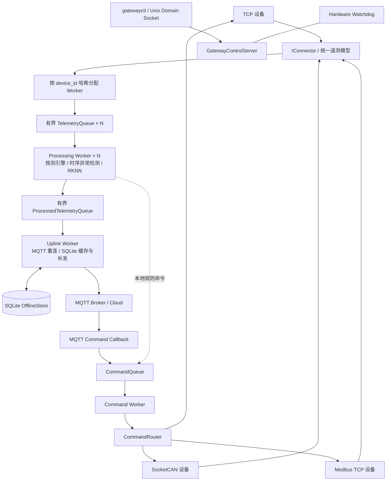

# Industrial Edge Gateway

**基于 C++17 / Embedded Linux 的多协议工业边缘智能网关**

面向工业设备异构接入、可靠遥测上报与边缘智能分析，项目以 Linux 用户态服务 `gatewayd` 为核心，集成 **TCP / SocketCAN / Modbus TCP、epoll + eventfd、设备亲和性 Worker、MQTT QoS 1、SQLite 离线补发、规则引擎以及 RK3576 NPU 时序异常检测**。

- **RK3576**：部署多变量时序异常检测模型，通过 RKNN Runtime 在 NPU 上推理；提供独立的板端配置 `config/gateway.rk3576.yaml`。
- **i.MX6ULL**：完成 Buildroot Linux / ARM 交叉编译部署、工业通信链路与硬件 Watchdog 验证；保留板端配置 `config/gateway.imx6ull.yaml`。
- **Ubuntu**：提供可复现的 TCP / Modbus 模拟设备、`vcan0`、Mosquitto 和本地管理工具。

> 项目定位：面向嵌入式 Linux 软件开发的工程实践原型，重点关注协议解耦、消息有序处理、异常恢复、背压、板端部署和可观测性；不宣称已达到商用工业产品认证要求。

## 1. 系统架构



### 遥测上行

```text
设备（TCP / CAN / Modbus）
  → Connector 协议解析
  → TelemetryMessage
  → 按 device_id 哈希选定有界队列
  → Processing Worker（规则、异常检测、必要时 NPU 推理）
  → ProcessedTelemetry（消息 + 序列化后的 JSON）
  → Uplink Worker
  → MQTT QoS 1
      └─ Broker 不可用：SQLite 落盘 → 重连后补发
```

同一 `device_id` 通过设备亲和性路由进入固定的处理 Worker，从而维护单设备时序状态。处理队列和上行队列职责分离：**入口队列满时拒绝新消息并计入 Dropped；上行队列满时等待容量释放，向前传递背压**。

### 控制下行

```text
MQTT JSON 命令
  → CommandConverter::fromJson() → DeviceCommand
  → CommandQueue → Command Worker
  → CommandRouter（device_id → IConnector）
      ├─ TCP：构建长度头 + JSON 帧 → pending_commands_
      │       → eventfd 唤醒 TCP I/O 线程 → send_buffer → EPOLLOUT → send()
      ├─ CAN：转换并发送 CAN 帧
      └─ Modbus：执行目标寄存器写操作
```

本地规则引擎生成的 `DeviceCommand` 也复用同一条 `CommandQueue → CommandRouter` 控制链路。

## 2. 核心设计与实现

| 模块 | 实现重点 |
| --- | --- |
| 多协议接入 | `IConnector` 统一接口；TCP、SocketCAN、Modbus TCP 的独立协议适配 |
| TCP 并发 I/O | 非阻塞 Socket、`epoll`、每连接读写缓冲区、4 字节网络序长度头、粘包/半包解析、部分发送、动态 `EPOLLOUT` |
| 跨线程通知 | 业务线程通过共享待发送队列传递任务，用 `eventfd` 唤醒 TCP I/O 线程；由 I/O 线程统一调用 `send()` |
| 多 Worker 调度 | `runtime.worker_threads` 配置并行度；按 `hash(device_id) % N` 路由，支持设备亲和性处理 |
| 队列与背压 | 多个有界遥测入口队列、有界上行队列、有界命令队列；分别执行丢弃计数、等待/唤醒等策略 |
| 可靠上报 | MQTT QoS 1、SQLite Store-and-Forward、Broker 断线重连、历史遥测补发 |
| 边缘分析 | 本地阈值/持续时间/冷却时间规则，滑动窗口异常评分，RK3576 的 RKNN 时序模型推理 |
| 运维可靠性 | systemd 服务、自检与硬件 Watchdog、进程及队列状态查询 |

**TCP 下行通知的实际执行顺序**：`TcpConnector::sendCommand()` 在持有 `pending_commands_mutex_` 时，先 `write(wake_fd_)`，成功建立唤醒条件后将封装好的帧放入 `pending_commands_`，再释放锁；I/O 线程收到 `wake_fd_` 的 **`EPOLLIN`**，读取通知并提取命令，随后给目标客户端 Socket 开启 **`EPOLLOUT`**，按可写状态发送。`eventfd` 不直接传输命令，也不等同于客户端 Socket 的可写事件。

## 3. RK3576 NPU 边缘异常检测

基于工业时序数据构建多变量异常检测推理链路，包含：

1. 使用 PyTorch 模型并导出 ONNX，执行 ONNX → RKNN 转换（见 `ml/convert_onnx_to_rknn.py`）。
2. 依据 `preprocess.json` 提取 8 维特征，执行与训练阶段一致的归一化。
3. 维护 **64 × 8** 滑动时间窗口，在满足推理条件时调用 RKNN Runtime。
4. 将推理结果转换为异常概率及判断结果，作为遥测指标进入现有处理链路。
5. 使用 `tools/rknn_model_smoke_test.cpp` 进行模型加载、数值对照和推理性能检查。

板端配置：`config/gateway.rk3576.yaml`。示例模型和预处理资源位于 `models/ai/skab_valve_v1/`；其中 SKAB 演示设备与 Modbus 模拟 PLC 分开配置。

## 4. 测试记录

以下为项目实机及故障测试的阶段性记录；具体性能取决于测试配置、设备负载、Broker 环境和统计口径，不能直接外推到任意工业现场。

| 场景 | 配置 / 结果 |
| --- | --- |
| TCP 并发 | RK3576；100 个 TCP 客户端、约 500 msg/s，5000 条遥测完整送达 |
| 长稳运行 | RK3576；50 个客户端、200 msg/s，运行 **26 h**，累计约 **1872 万** 条遥测；记录 Dropped=0、进程无重启 |
| MQTT 离线恢复 | Broker 故障期间缓存，恢复后 **1125 条** 离线遥测无缺失恢复 |
| 进程故障恢复 | systemd 自动拉起服务；一次测试记录约 **3.45 s** 恢复 MQTT 连接 |
| NPU 数值一致性 | 509 个验证窗口的分类结果与 PyTorch 一致 |
| NPU 效果与性能 | F1 **0.8441**；64 × 8 输入窗口，板端平均推理约 **9.86 ms**、约 **101 次/s** |
| i.MX6ULL 看门狗 | 使用 `SIGSTOP` 模拟用户态进程假死，硬件 Watchdog 可触发板级复位并随系统启动恢复服务 |

> 上述 RK3576 数值来自本项目阶段性测试记录；仓库快照中的源码和配置能够说明实现方式，但仅凭源码无法独立复核全部实测数字。正式复现时应配套保存压测脚本、原始日志、时间区间及结果统计方法。**MQTT QoS 1 提供至少一次交付语义，并不保证消息绝对不重复。**

## 5. 源码目录

```text
industrial-edge-gateway/
├── src/
│   ├── connectors/      # TCP / SocketCAN / Modbus TCP / Mock
│   ├── core/            # GatewayContext、CommandRouter、各类队列
│   ├── model/           # TelemetryMessage、DeviceCommand、ProcessedTelemetry
│   ├── converters/      # 遥测与控制 JSON 转换
│   ├── rules/           # 本地规则引擎
│   ├── anomaly/         # 滑动窗口异常检测
│   ├── ai/              # RKNN Runtime 与时序模型集成
│   ├── mqtt/            # MQTT Publisher / Subscriber
│   ├── storage/         # SQLite OfflineStore
│   ├── control/         # Unix Domain Socket 控制接口
│   ├── health/          # Hardware Watchdog
│   └── common/          # 配置、日志、进程指标
├── tools/               # gatewayctl / TCP / Modbus 模拟器 / RKNN 测试
├── tests/               # 基础测试
├── config/              # Ubuntu / i.MX6ULL / RK3576 配置
├── ml/                  # RKNN 模型转换、参考输出与数据注入脚本
├── models/ai/           # 模型及预处理资源
├── cmake/               # ARM / Buildroot 工具链配置
├── deploy/              # systemd、udev
├── docker/mosquitto/    # Broker 开发配置
└── CMakeLists.txt
```

## 6. Ubuntu 本地构建与运行

### 安装依赖

```bash
sudo apt update
sudo apt install -y \
  build-essential cmake pkg-config \
  libyaml-cpp-dev libspdlog-dev nlohmann-json3-dev \
  libsqlite3-dev libmodbus-dev \
  libpaho-mqtt-dev libpaho-mqttpp-dev \
  mosquitto mosquitto-clients can-utils sqlite3
```

### 编译

```bash
git clone https://github.com/YIMOUSHUI/industrial-edge-gateway.git
cd industrial-edge-gateway
cmake -S . -B build -DCMAKE_BUILD_TYPE=Release
cmake --build build -j"$(nproc)"
```

主要程序：`build/gatewayd`、`build/gatewayctl`、`build/tcp_device_simulator`、`build/modbus_device_simulator`。若本机安装了匹配的 RKNN Runtime 和头文件，还会生成 `rknn_model_smoke_test`；普通 Ubuntu 环境允许不启用 RKNN 后端。

### 启动演示环境

先在仓库根目录初始化软件 CAN 接口：

```bash
sudo modprobe vcan
sudo ip link add dev vcan0 type vcan 2>/dev/null || true
sudo ip link set dev vcan0 up
```

然后在不同终端分别启动：

```bash
# 终端 A：Broker（从仓库根目录执行）
mosquitto -c docker/mosquitto/mosquitto.conf -v

# 终端 B：Modbus 模拟 PLC
./build/modbus_device_simulator

# 终端 C：网关（默认使用 config/gateway.yaml）
./build/gatewayd config/gateway.yaml

# 终端 D：本地管理工具
./build/gatewayctl status
./build/gatewayctl devices
./build/gatewayctl health
```

注意避免同时启动系统自带 Mosquitto 服务与上述 Broker 而占用同一个 `1883` 端口。

订阅遥测：

```bash
mosquitto_sub -h 127.0.0.1 -p 1883 \
  -t 'gateway/gateway-01/telemetry' -v
```

发送 Modbus 控制命令：

```bash
mosquitto_pub -h 127.0.0.1 -p 1883 \
  -t 'gateway/gateway-01/command' \
  -m '{"request_id":"cmd-001","device_id":"modbus-plc-01","action":"set_speed","parameters":{"value":1200}}'
```

默认 Modbus 模拟器在本地监听 `1502` 端口；命令写入完成后可通过下一轮轮询遥测检查转速寄存器回读情况。

## 7. 嵌入式板端部署

### i.MX6ULL / Buildroot

项目提供 `cmake/arm-buildroot-toolchain.cmake`。交叉编译前需要根据自己的 Buildroot SDK / sysroot 调整该文件中的工具链路径，并在目标根文件系统准备依赖库。

```bash
cmake -S . -B build-arm -DCMAKE_BUILD_TYPE=Release \
  -DCMAKE_TOOLCHAIN_FILE=cmake/arm-buildroot-toolchain.cmake
cmake --build build-arm -j"$(nproc)"
```

部署时使用 `config/gateway.imx6ull.yaml`，并根据板端的 `can0`、Broker 地址和设备连接情况调整配置。

### RK3576 / RKNN

仓库包含 `config/gateway.rk3576.yaml`，用于 RK3576 场景；在已正确安装 RKNN Runtime、模型和全部项目依赖的 RK3576 Linux 环境中构建并运行：

```bash
./build/gatewayd config/gateway.rk3576.yaml
```

这里的 `build/gatewayd` 指 **在 RK3576 平台编译得到的程序**，不能直接使用 Ubuntu x86_64 或 i.MX6ULL ARM32 构建产物。当前 CMake 按可用的 RKNN 头文件和 `librknnrt` 决定是否启用 RKNN 后端；该配置还依赖本机的 `can0`、Mosquitto 和 Modbus 测试端，运行前须核对这些服务及 `/dev/watchdog0` 的实际状态。

## 8. 工程说明

- **协议与模型解耦**：MQTT 上报和规则处理面向统一遥测模型，不直接依赖原始 TCP 字节、CAN ID 或 Modbus 寄存器布局。
- **设备级时序**：设备亲和性便于维护规则和 NPU 滑动窗口状态，不代表整个系统具有严格的全局消息顺序。
- **错误与过载可观测**：通过 `gatewayctl`、队列长度、Dropped、线程数、RSS、Open FD 等指标观察运行状态。
- **离线容错边界**：SQLite 的补发策略提升 Broker 故障期间的数据保留能力；极端情况下仍需结合数据库持久化策略、断电恢复和云侧幂等去重评估交付保证。
- **真实 CAN 与 vcan**：软件虚拟 CAN 验证不等同于物理 CAN 总线极限吞吐测试。

本仓库用于展示嵌入式 Linux、网络编程、工业通信、可靠消息处理和 RK3576 NPU 推理的系统开发实践。
