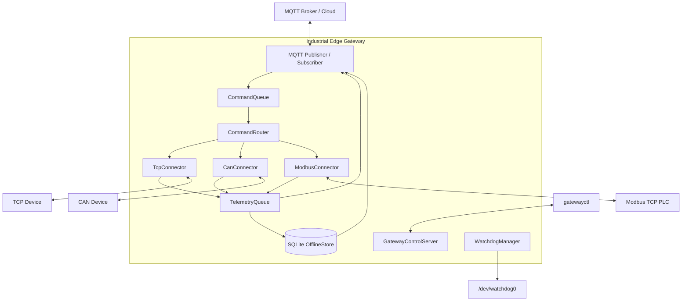
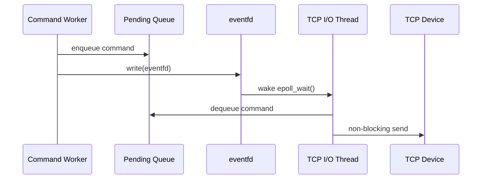

# Industrial Edge Gateway

> 基于 **C++17 / Embedded Linux** 的多协议工业边缘网关。  
> 面向工业设备数据采集、云端遥测上报与远程控制场景，已完成 **i.MX6ULL + Buildroot Linux** 板端部署、故障恢复验证与 24 h 长稳测试。

## Overview

本项目实现一个运行在嵌入式 Linux 设备上的工业边缘网关：南向统一接入 **TCP、SocketCAN、Modbus TCP** 设备，北向通过 **MQTT** 与云端通信，并围绕设备通信场景实现消息路由、离线存储、故障恢复、硬件 Watchdog 和运行状态观测。

核心关注点不是简单“接入多个协议”，而是完整的 Linux 设备端软件工程链路：

- `epoll + non-blocking socket + eventfd` TCP I/O 事件循环
- 多协议 `IConnector` 抽象与统一 Telemetry / Command 数据模型
- 线程安全有界队列与过载保护
- MQTT 断网容错与 SQLite Store-and-Forward
- MQTT → CommandRouter → Device 双向控制链路
- `/dev/watchdog0` 硬件 Watchdog 与进程假死恢复
- Unix Domain Socket 管理面与 `gatewayctl` 运行状态查询
- Ubuntu 开发验证 + Buildroot ARM 交叉编译 + i.MX6ULL 板端部署

---

## Architecture



### Telemetry Path

```text
TCP / CAN / Modbus Device
          │
          ▼
      IConnector
          │
          ▼
 TelemetryMessage
          │
          ▼
   TelemetryQueue
          │
          ▼
 Telemetry Worker
      │         │
      │         └── MQTT unavailable ──> SQLite OfflineStore
      │                                      │
      └── MQTT publish <──────────────────────┘
                  Broker recovery / replay
```

### Command Path

```text
MQTT Command
     │
     ▼
CommandConverter
     │
     ▼
 CommandQueue
     │
     ▼
CommandRouter
     │
     ├── TcpConnector
     ├── CanConnector
     └── ModbusConnector
             │
             ▼
           Device
```

---

## Key Features

### 1. Linux TCP I/O

`TcpConnector` 基于 Linux I/O 多路复用管理设备长连接：

- non-blocking socket
- `epoll` I/O event loop
- `eventfd` 跨线程唤醒
- 4-byte length-prefix 应用层帧协议
- TCP 粘包 / 拆包处理
- partial send 与发送缓冲区管理
- 动态 `EPOLLOUT` 关注
- 异常断连与 fd 生命周期清理
- `device_id -> connection` 路由关系维护

业务线程不会直接操作 TCP connection socket。下行命令进入待发送队列后，通过 `eventfd` 唤醒阻塞在 `epoll_wait()` 的 I/O Thread，由 I/O Thread 统一处理 socket 写操作。



### 2. Unified Connector Model

不同南向协议统一实现 `IConnector`，由 `GatewayContext` 管理生命周期与消息回调。

| Connector | Function |
| --- | --- |
| TCP | 工业 TCP 设备接入与双向命令下发 |
| SocketCAN | Linux CAN 接收 / 发送，开发环境使用 `vcan0` |
| Modbus TCP | PLC 周期轮询、自动重连、Holding Register 写入 |
| Mock | 本地链路验证 |

南向数据统一转换为 `TelemetryMessage`，下行控制统一转换为 `DeviceCommand`，上层业务不直接依赖具体协议实现。

### 3. Bounded Queue & Overload Protection

协议 I/O 与业务 Worker 通过线程安全有界队列解耦：

- `TelemetryQueue`: capacity = 1000
- `CommandQueue`: capacity = 100
- `mutex + condition_variable`
- 满载时拒绝新消息，避免内存无界增长
- TelemetryQueue 提供显式 `Dropped Counter`

过载验证：容量 1000、无消费者持续 push 2000 条消息。

```text
accepted = 1000
rejected = 1000
dropped  = 1000
```

### 4. MQTT Store-and-Forward

Broker 不可用时，Gateway 不停止南向设备采集：

1. MQTT publish 失败或连接断开；
2. 遥测数据写入 SQLite `offline_messages`；
3. Telemetry Worker 继续消费设备数据；
4. MQTT 连接周期性重试；
5. Broker 恢复后自动批量补发历史消息；
6. 单条消息 publish 成功后再删除对应 SQLite 记录。

当前离线补发批次大小为 100 条，MQTT 断线重连节流间隔为 5 s。

### 5. Bidirectional Control

MQTT Callback 仅负责接收、校验和入队，不直接执行可能阻塞的设备 I/O。

示例：通过 MQTT 修改 Modbus PLC 的转速寄存器。

```json
{
  "request_id": "cmd-001",
  "device_id": "modbus-plc-01",
  "action": "set_speed",
  "parameters": {
    "value": 1200
  }
}
```

执行链路：

```text
MQTT
  -> CommandConverter
  -> CommandQueue
  -> Command Worker
  -> CommandRouter
  -> ModbusConnector
  -> Holding Register 2
```

写入后由下一轮 Modbus 周期采集再次读回，实现控制与状态回读闭环。

### 6. Hardware Watchdog

i.MX6ULL 板端通过 `/dev/watchdog0` 使用硬件 Watchdog：

```yaml
watchdog:
  enabled: true
  device: /dev/watchdog0
  timeout_sec: 15
  feed_interval_sec: 5
  health_timeout_sec: 60
```

Watchdog 不只检查 `gatewayd` 进程是否存在，而是根据核心 Worker 是否能够继续推进决定是否喂狗。

实际使用 `SIGSTOP` 暂停正式 `gatewayd`，模拟“进程仍存在但完全假死”的场景：约 15 s 后硬件复位，Linux 重启后服务自动恢复。

### 7. Runtime Observability

`gatewayd` 通过 Unix Domain Socket 提供本地控制面：

```text
/tmp/gateway.sock
```

配套 `gatewayctl`：

```bash
./build/gatewayctl status
./build/gatewayctl devices
./build/gatewayctl health
```

可查看：MQTT 状态、在线设备、Queue 深度、Dropped、RSS、Open FD、线程数、Uptime 等运行指标。

---

## Reliability & Stress Tests

| Test | Scenario | Result |
| --- | --- | --- |
| TCP churn | 连续 200 次 connect / disconnect | `gatewayd` 持续运行，Open FD **13 → 13**，无残留 ESTABLISHED 连接 |
| TCP recovery | 客户端异常退出后重新连接 | Gateway 不退出，设备路由与下行链路恢复 |
| CAN stress | `vcan`, ~100 fps × 1000 frames | Open FD **13 → 13**，RSS ~**10772 → 10784 KB** |
| CAN high load | `vcan`, ~1000 fps × 10000 frames | `gatewayd` 存活，Open FD 保持 **13** |
| CAN burst investigation | `cangen -g 0 -n 20000` | 定位部分帧在进入应用 Queue 前已于内核 / SocketCAN 接收路径丢弃 |
| Queue overload | capacity 1000, push 2000 | **1000 accepted / 1000 rejected / 1000 dropped** |
| MQTT offline | 主动停止 Mosquitto | Gateway 继续运行，遥测持久化进入 SQLite |
| MQTT recovery | Broker 重启，不重启 `gatewayd` | 自动重连与补发，最终 `offline_messages = 0` |
| Modbus polling | i.MX6ULL → Ubuntu 模拟 PLC，1 s polling | 温度、湿度、转速正常读取并 MQTT 上报 |
| Modbus downlink | MQTT `set_speed` → HR2 | 1500 → 1200 / 1350，并在下一轮采集中读回 |
| Modbus recovery | PLC 主动退出再恢复 | Gateway 不退出，Connector 自动重连 |
| Watchdog stall | 对正式 `gatewayd` 执行 `SIGSTOP` | 约 **15 s** 后整板硬件复位，系统启动后服务自动恢复 |
| Soak test | i.MX6ULL 正式环境持续运行 | **24 h passed** |

> CAN 压力数据基于 Linux `vcan` 软件接口，用于验证应用侧 SocketCAN 接收链路和资源稳定性，不等同于真实物理 CAN 总线的极限吞吐能力。

---

## Platform & Dependencies

### Target

- NXP i.MX6ULL / ARM Cortex-A7
- Buildroot Linux
- SocketCAN
- `/dev/watchdog0`

### Development Host

- Ubuntu Linux
- GCC / G++
- CMake >= 3.16
- Mosquitto
- SQLite3
- libmodbus

### C++ Libraries

- yaml-cpp
- spdlog
- nlohmann/json
- Eclipse Paho MQTT C / C++
- SQLite3
- libmodbus

Ubuntu / Debian 开发环境可安装：

```bash
sudo apt update
sudo apt install -y \
  build-essential cmake pkg-config \
  libyaml-cpp-dev libspdlog-dev nlohmann-json3-dev \
  libsqlite3-dev libmodbus-dev \
  libpaho-mqtt-dev libpaho-mqttpp-dev \
  mosquitto mosquitto-clients can-utils
```

---

## Build

```bash
git clone https://github.com/YIMOUSHUI/industrial-edge-gateway.git
cd industrial-edge-gateway

cmake -S . -B build -DCMAKE_BUILD_TYPE=Release
cmake --build build -j"$(nproc)"
```

主要可执行文件：

```text
build/gatewayd
build/gatewayctl
build/tcp_device_simulator
build/modbus_device_simulator
```

---

## Quick Start on Ubuntu

### 1. Start MQTT Broker

```bash
mosquitto -c docker/mosquitto/mosquitto.conf -v
```

### 2. Create `vcan0`

```bash
sudo modprobe vcan
sudo ip link add dev vcan0 type vcan 2>/dev/null || true
sudo ip link set dev vcan0 up
ip -details link show vcan0
```

### 3. Start Modbus PLC Simulator

```bash
./build/modbus_device_simulator
```

默认监听 `0.0.0.0:1502`，初始 Holding Registers：

```text
HR0 = 250   -> 25.0 °C
HR1 = 600   -> 60.0 %
HR2 = 1500  -> 1500 rpm
```

### 4. Start Gateway

```bash
./build/gatewayd
```

开发配置：`config/gateway.yaml`

### 5. Inspect Runtime Status

```bash
./build/gatewayctl status
./build/gatewayctl devices
./build/gatewayctl health
```

### 6. Subscribe Telemetry

```bash
mosquitto_sub \
  -h 127.0.0.1 \
  -p 1883 \
  -t 'gateway/gateway-01/telemetry' \
  -v
```

### 7. Send Modbus Command

```bash
mosquitto_pub \
  -h 127.0.0.1 \
  -p 1883 \
  -t 'gateway/gateway-01/command' \
  -m '{"request_id":"cmd-001","device_id":"modbus-plc-01","action":"set_speed","parameters":{"value":1200}}'
```

下一轮 Modbus 遥测中应读取到 `speed = 1200 rpm`。

---

## MQTT Offline Recovery Demo

Gateway 运行过程中停止 Broker：

```bash
sudo systemctl stop mosquitto
```

查询离线消息：

```bash
sqlite3 gateway.db 'SELECT COUNT(*) FROM offline_messages;'
```

恢复 Broker：

```bash
sudo systemctl start mosquitto
```

Gateway 无需重启，会自动重新连接并补发历史数据。补发完成后：

```bash
sqlite3 gateway.db 'SELECT COUNT(*) FROM offline_messages;'
```

预期：

```text
0
```

---

## ARM / Buildroot Cross Compilation

项目提供：

```text
cmake/arm-buildroot-toolchain.cmake
```

首次使用前设置 toolchain 中的 `BUILDROOT_DIR`，并确保 Buildroot staging 中已包含项目依赖库。

```bash
cmake \
  -S . \
  -B build-arm \
  -DCMAKE_BUILD_TYPE=Release \
  -DCMAKE_TOOLCHAIN_FILE=cmake/arm-buildroot-toolchain.cmake

cmake --build build-arm -j"$(nproc)"
```

板端配置参考：

```text
config/gateway.imx6ull.yaml
```

真实 CAN 接口：

```yaml
- name: can-bus
  type: can
  enabled: true
  interface: can0
```

硬件 Watchdog：

```yaml
watchdog:
  enabled: true
  device: /dev/watchdog0
  timeout_sec: 15
  feed_interval_sec: 5
  health_timeout_sec: 60
```

---

## Project Structure

```text
industrial-edge-gateway/
├── src/
│   ├── common/          # Config / logger / process metrics
│   ├── connectors/      # TCP / SocketCAN / Modbus / Mock
│   ├── control/         # Unix Domain Socket control plane
│   ├── converters/      # Telemetry / Command conversion
│   ├── core/            # GatewayContext / Queue / CommandRouter
│   ├── health/          # Hardware Watchdog
│   ├── model/           # Unified data model
│   ├── mqtt/            # MQTT publisher / subscriber
│   └── storage/         # SQLite OfflineStore
├── tools/
│   ├── gatewayctl.cpp
│   ├── tcp_device_simulator.cpp
│   └── modbus_device_simulator.cpp
├── tests/               # Smoke tests
├── config/              # Ubuntu / i.MX6ULL configuration
├── cmake/               # Buildroot ARM toolchain
├── docker/mosquitto/    # Development broker config
└── CMakeLists.txt
```

---

## Design Notes

- **Bounded queue instead of unlimited buffering**: overload is exposed explicitly through Dropped Counter rather than being converted into uncontrolled memory growth.
- **MQTT failure is treated as degraded mode, not whole-system failure**: southbound acquisition continues and telemetry is persisted locally.
- **Socket ownership stays inside the TCP I/O thread**: business threads deliver commands through queue + `eventfd`, reducing shared connection-state access.
- **Watchdog focuses on progress, not process existence**: external dependency failures such as MQTT disconnect do not automatically trigger a board reset; core worker stall does.

---

## Notes

- `1000 fps / 10000 frames` CAN stress testing uses Linux `vcan`; it validates the software receive path and process stability, not physical CAN bus peak throughput.
- This repository is an embedded Linux systems programming / industrial communication project and does not claim commercial product certification.

